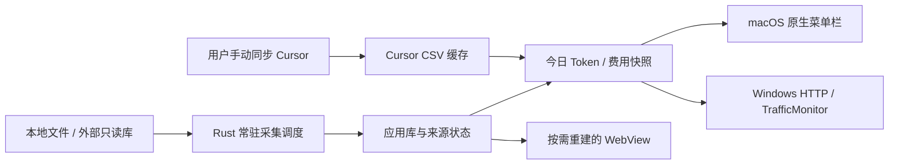

# 轻量模式与状态栏数据链路审计

审计日期：2026-10-10。代码版本：0.8.8，main / 336a077。审计覆盖窗口生命周期、后台线程、全部 11 个用量源、今日统计与计价、macOS NSStatusItem、Windows TrafficMonitor 插件，以及初始化、缓存、错误与恢复路径。

**结论：销毁 WebView 并保留 Rust 应用的设计基本合理，但当前没有独立于前端的数据采集调度。关闭界面后，7 个本地扫描型源停止采集，因此本地来源的后台及时更新目标目前不成立。Cursor 按用户约定采用后台缓存展示，排除在后台自动同步与实时更新目标之外。**

同步约定（2026-10-10）：基于用户降低 Cursor API 请求频率的要求，后续轻量模式修复不新增后台 Cursor API 自动请求，也不缩短现有前台自动同步的 24 小时有效期。需要最新 Cursor 用量时，由用户手动同步；状态栏允许显示已有 CSV 缓存，并可标注最后同步时间。

本次审计未修改产品代码或外部数据库。动态验证在临时工作目录中使用隔离 Rust 副本、临时 SQLite 与临时 PI 会话，另对 Windows WinHTTP 做了本机 API 验证。下文的修复建议均未实施。

## 界面释放与后台存活

- `services/headless.rs:258` 调用 `window.destroy()`，没有用隐藏窗口冒充轻量模式。默认普通关闭仍为 hide；“关闭窗口时销毁界面”只设置后续关闭行为，“立即进入后台模式”才马上销毁窗口。
- 当前 lockfile 的 Tauri 2.11.0 / tauri-runtime-wry 2.11.0 / Wry 0.55.0：destroy 向事件循环发送销毁消息；WebView 最后引用释放后，Windows 实现调用 WebView2 controller.Close()；Windows/macOS 的 WebContext 在没有引用时移除。这条资源释放链路正确。
- `lib.rs:449` 对后台模式下无退出码的 ExitRequested 执行 prevent_exit；显式 app.exit(0) 仍能退出。菜单、托盘、重复启动与 macOS Reopen 都接入重建入口，重建后的窗口继续受到 Builder 级关闭拦截保护。
- `menubar.rs:48` 与 `http_server.rs:41` 分别启动独立 Rust 线程，持有独立查询连接；销毁 WebView 不会关闭这两个服务。macOS 状态项由原生对象保活，更新通过主线程进行。
- destroy 返回表示销毁消息已提交，不等于操作系统子进程已全部退出。这次没有实测窗口切换后的 WebView2/WKWebView 子进程与内存变化；macOS 仅做代码审查。先前 ADR 的 macOS 内存测量属于历史证据，不作为这次测量结果。
- Rust 侧 data_sources、Cursor CSV 全量内存记录、请求缓存和状态栏数据源缓存仍保留。WebView 释放不代表所有前台查询内存均释放。

## 数据源逐项结果

| 数据源 | 界面销毁后的采集/读取 | 状态栏新鲜度 |
|---|---|---|
| CCS | 独立只读 SQLite 查询能读取外部新提交的数据 | 通常可随下一次今日查询更新；依赖 CCS 自己写入 |
| OpenCode | 同上 | 同上 |
| AIProxy | 同上 | 同上 |
| Cursor | 后台仅读取已经下载的 usage.csv；按用户约定保持此行为 | 缓存展示，允许滞后；需要最新数据时手动同步，保留现有前台 24 小时有效期 |
| ZCode | 读取 pricing.db 已导入记录；不再调用源 SQLite 导入器 | 停在最后一次导入，直到前台或手动命令再次触发 |
| Proma | 读取 pricing.db；不再扫描 JSONL | 同上 |
| DSH | 读取 pricing.db；会话/插件两种扫描都失去调度 | 同上 |
| MiniMax | 读取 pricing.db；不再读取源 SQLite/JSONL 并导入 | 同上 |
| Antigravity | 读取 pricing.db；不再请求 language server RPC | 同上；IDE 关闭时还受上游可用性限制 |
| Kimi | 读取 pricing.db；不再扫描 wire.jsonl | 同上 |
| PI | 读取 pricing.db；不再扫描 pi/OMP/profile 会话 | 同上，已动态复现 |

Grok 是会话元数据能力，不是第 12 个独立用量源。

## 需要优先修复的问题

### 1. P1：扫描调度随 WebView 销毁而消失

证据：`src/components/layout/AppLayout.vue:134` 的前端定时器调用 refreshDatabase；`src/composables/useAutoRefresh.ts:51` 创建 JS interval；`src-tauri/src/commands/database.rs:651` 才执行 MiniMax、Antigravity、Proma、ZCode、Kimi、PI、DSH 扫描。初始导入和手动扫描同样位于前端可调用命令中。后台唯一两个常驻服务直接进入 `today_query.rs:150` 的 compute_precompute，它是读取/聚合流程，不会扫描和入库。重建 DataSource 也仅打开查询数据库。

复现：临时 PI 会话含一条有效的 660 Token 新记录，实际解析器可解析，实际 scanner 可向隔离内存库导入 1 条；连续 3 次实际后台今日查询仍为旧值 110。把派生记录写入临时应用库后，后台查询才变为 770。

建议：把扫描调度提到 Rust 常驻服务中，前端刷新与状态栏查询共享采集结果。支持文件变化通知与定时补扫，避免 UI、菜单栏和 HTTP 分别扫描同一份源；遵守启用源范围、请求去重、DSH 模式与自定义目录。只写应用自有库。

### 2. P1：Windows 插件实际断连时不会自动发现新端口

证据：`traffic-monitor-plugin/CCSwitchAnalyzer.cpp:226` 仅在 WinHttpConnect 返回空句柄时执行 AutoDiscoverPort；真正连接服务器发生在 WinHttpSendRequest / WinHttpReceiveResponse，失败分支（252–269）直接返回。OnInitialize 也只读配置，没有主动发现。m_discovery_attempted 置 true 后未在成功恢复时重置。

Windows API 实测：针对一个确认无人监听的临时端口，WinHttpConnect 仍返回有效句柄；WinHttpSendRequest 返回 false，错误码 12029。与当前代码组合，端口发现分支不会被调用。

触发：19810 被占用时 Rust 服务回退到 19811–19820，或者快速停开 HTTP 服务时旧线程尚未释放端口。插件可能一直查询原端口，持续显示断连。

建议：在真实请求失败时按节流/退避执行端口发现，成功后重置失败状态；不要在每次宿主刷新里阻塞扫描全部端口。服务停止时也应确认监听线程退出后再重新绑定。

### 3. P2：数据源失败被表现为正常零用量或部分总量

证据：`services/pipeline.rs:120` 把查询失败转换成 None，`today_query.rs:141` 把打开失败转换成 None，剩余数据继续组成成功结果。没有附带缺失来源、部分结果或最后成功时间。

复现：临时数据源正常返回 110 Token；把临时表改名使查询报错后，实际后台查询仍返回 Ok，Token 和请求数均为 0。因此 HTTP 可返回 200，菜单栏显示正常的 0.00。

建议：保留来源级错误状态；全部失败返回错误，部分失败明确标记结果不完整，可保留上次成功值并标注过期。缓存中打开失败的来源也需重试，不能只等待 signature/mtime 改变。

### 4. P2：常驻查询成本随全部历史增长

证据：DSH、Proma、MiniMax、Antigravity、ZCode、Kimi、PI 的 filtered_records SQL 只筛 source，再在 Rust 中按日期过滤，例如 `services/dsh_db.rs:73`、`services/pi_db.rs:74`。每次今日查询还通过 `commands/query.rs:403` 计算供应商、趋势、对比桶等多个前台统计结构。

隔离 debug 数据：今日始终只有 1 条记录；同一查询从 5.721ms 增长到加入 100,000 条历史记录后的 215.634ms，约 38 倍。这是合成 debug 观测，不是 release 性能承诺。扫描型源越多、历史越大，后台线程的 CPU/SQLite 工作越多；HTTP 单线程顺序处理会受到影响，插件还设置了 2 秒响应超时。

建议：在应用自有库查询中把今日范围下推到 SQL，按真实访问模式为应用库增加 source+created_at 索引；不得给外部库建索引。抽取只算 Token/费用的今日聚合，采集未变化时复用共享快照，避免每 30 秒构造整套前台数据。

### 5. P2：窗口重建的尺寸口径不一致

证据：`services/headless.rs:210` 保存 outer_size，`headless.rs:243` 使用 set_size 恢复。当前 Tauri runtime 的 SetSize 实际调用 set_inner_size；标题栏与边框会被重复算入内容尺寸。

结果：有窗口装饰的平台上，反复销毁/重建可能逐次放大窗口。另一个相关问题是 `headless.rs:295` 对已有窗口的普通唤起也恢复旧几何，可能覆盖用户后来调整的大小/位置；最大化时也未保留正常窗口的独立尺寸。这些是 API 口径与控制流发现，本次未进行真机 UI 复现。

建议：统一保存/恢复 inner_size，在真正新建时才恢复几何，保留 normal/maximized 两套状态。

## 刷新、缓存与恢复细节

- **macOS**：`menubar.rs:16` 为 30 秒，实际周期是查询耗时 + 30 秒；不是事件驱动的秒级更新。stop 在查询中发生时，旧查询完成后仍会执行 `menubar.rs:99` 的 apply_title，没有再次检查 shutdown 或运行代次；可能把清空后的文字写回来。应在提交主线程更新前、以及主线程回调内核对有效代次。
- **Windows**：TrafficMonitor 的 DataRequired 由宿主调度，频率无法从本仓库保证；`utils.rs:17` 的 HTTP 结果缓存为 30 秒，端到端延迟还包含宿主调用间隔与查询耗时。`http_server.rs:193` 只按 tz/TTL 判断缓存，没有数据版本、筛选版本、定价版本或自然日键。实测插入新行或禁用来源后，TTL 内仍返回旧 110；缓存到期才更新。午夜、改价或改 CCS 过滤时也可能短暂返回旧值。
- **初始化依赖前端**：`lib.rs:84` 的 data_sources 初始为空，PricingEngine::new 同样为空；源恢复与价格加载靠 `AppLayout.vue:168` 的 autoLoadDatabase。若 WebView 没能完成挂载或在初始化前立即进入后台，Rust 服务没有独立自恢复入口，可能一直显示占位符。应把源与定价初始化放进 Rust setup/后台服务，前端只订阅状态。
- **时区精度**：macOS `menubar.rs:90` 和 Windows 插件 `CCSwitchAnalyzer.cpp:213` 将时区截断为整小时。UTC+05:30 等地区的今日边界会差 30 分钟；today_query 固定 +86400 秒也未按本地日历处理夏令时切换日的 23/25 小时。中国时区不受这两个场景影响。建议按 IANA/系统时区计算自然日边界，协议至少支持分钟偏移。
- **缓存键冲突**：`today_query.rs:52` 和 120 的 mtime map 仅以 path 为键，多种扫描型源共享 pricing.db 时会覆盖彼此的 mtime。其查询连接每次读最新应用库，所以这个冲突不是本次扫描停止的原因；但会漏掉源级重建判断，应与前台 mtime 的 db_type+path 规则一致。
- **Windows 菜单文案**：后台状态文本只在托盘菜单的切换回调里更新；设置页进入、关闭窗口进入、托盘左键退出等路径不会更新同一菜单项。headless.rs 的 sync_tray_label 在非 macOS 是空实现，菜单可能描述相反动作。
- **窗口切换状态**：destroy 异步投递后立即写 active，没有 Destroyed 确认或 entering/exiting 状态，也没有失败时回滚外观。普通单次切换设计可工作；快速切换和创建失败路径应补状态机测试。这属于待真机验证的可靠性风险，不计为已复现的进程退出故障。

## 建议的目标链路

建议先解决本地采集断链和端口恢复，再优化查询与缓存。可以把本地源“数据已落盘后 5–10 秒内反映到状态栏”设为可测试目标，用文件通知 + 定时补扫实现。Cursor 后台保持缓存展示，用户手动同步后刷新统计，并可展示 lastSynced。HTTP 读取快照应快速响应，附带 computedAt、lastSuccessfulSync、stale/partial 状态。本地数据源在前台、隐藏、销毁界面三种状态采用同一后台采集机制，避免行为分叉。

需要验收：无 WebView 时给每种本地源追加记录；核对应用库与两端状态栏；确认 Cursor 后台刷新不触发 API 请求，并验证手动同步后的缓存更新；当天/跨午夜、改价/过滤、启停服务、服务端口变化、源故障恢复、睡眠唤醒、反复销毁/重建与显式退出；Windows/macOS 分别记录主进程和应用所属 WebView 子进程的内存及 CPU。

## 验证结果与限制

- 原仓库 `cargo test --locked --lib services::menubar::tests`：2 项格式测试通过；这不验证原生 UI 刷新或同步。
- 隔离副本 `cargo test --locked --lib lightweight_audit -- --nocapture --test-threads=1`：5 项审计探针通过。通过意味着复现了探针描述的现状，包含上述缺陷；不代表轻量模式验收通过。
- Windows WinHTTP 闭合临时端口验证：ConnectHandlePresent=true、SendSucceeded=false、SendError=12029。
- 仅审计源代码、隔离 Rust 逻辑与 Windows API；未操作真实 UI，未做实际子进程/常驻内存测量，macOS 原生行为待目标设备验证。
- 审计探针仅用于临时副本验证，未纳入产品测试；本报告记录当时的结果，后续修复需另行补充回归测试与决策记录。
